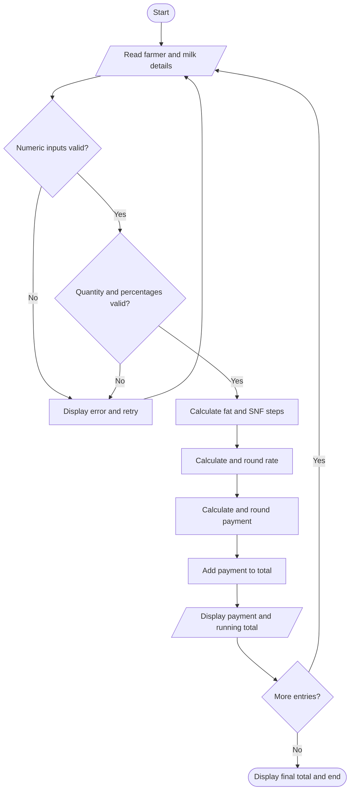

# Task 8 - Plan the Algorithm

## Problem-solving stages

1. Understand the inputs, outputs and business rules.
2. Plan validation and calculation steps.
3. Write the Python implementation.
4. Test normal values, boundary values and invalid entries.

## Pseudocode

BEGIN
    SET total = 0.00

    FOR each delivery
        READ farmer ID, shift, litres, fat, SNF
        CONVERT numeric text to decimal values

        IF input is invalid
            DISPLAY error
            REQUEST corrected input
        ELSE
            VALIDATE litres, fat and SNF ranges

            CALCULATE fat steps
            CALCULATE SNF steps

            rate = base rate
                   + fat steps * fat adjustment
                   + SNF steps * SNF adjustment

            ROUND rate to two decimal places
            payment = litres * rate
            ROUND payment to two decimal places

            total = total + payment
            DISPLAY rate and payment
        END IF
    END FOR

    DISPLAY ten-day total
END

## Flowchart



## Hand trace

| Farmer | Litres | Fat | SNF | Rate (Rs) | Payment (Rs) |
|---|---:|---:|---:|---:|---:|
| A | 10 | 3.5 | 8.5 | 30.00 | 300.00 |
| B | 8.5 | 4.2 | 8.7 | 33.40 | 283.90 |
| C | 12 | 3.1 | 8.3 | 27.80 | 333.60 |
| Total | | | | | 917.50 |

## Complexity analysis

Storing all n deliveries and processing them takes O(n) time and
O(n) space. Maintaining only a running total takes O(n) time and
O(1) additional space.

Storing records is still useful for audit trails, farmer statements,
corrections, and future recalculation.
```
